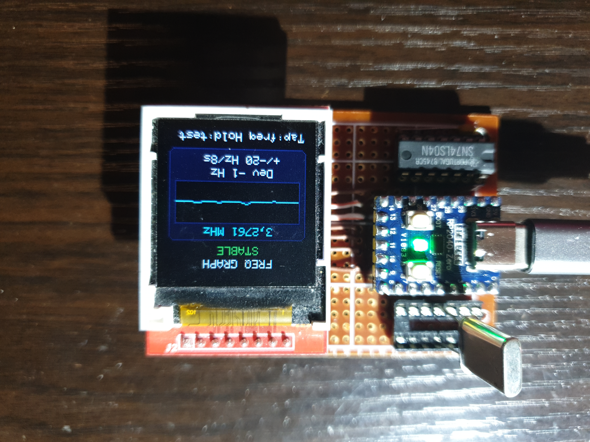
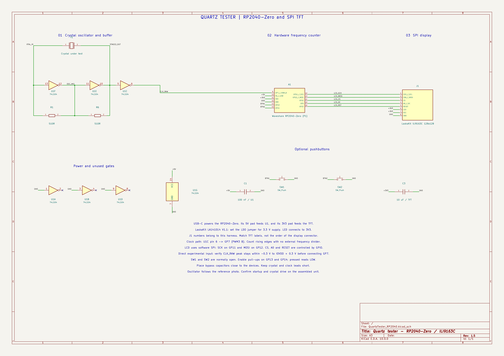
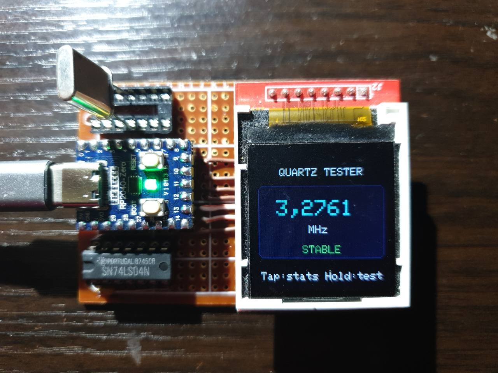
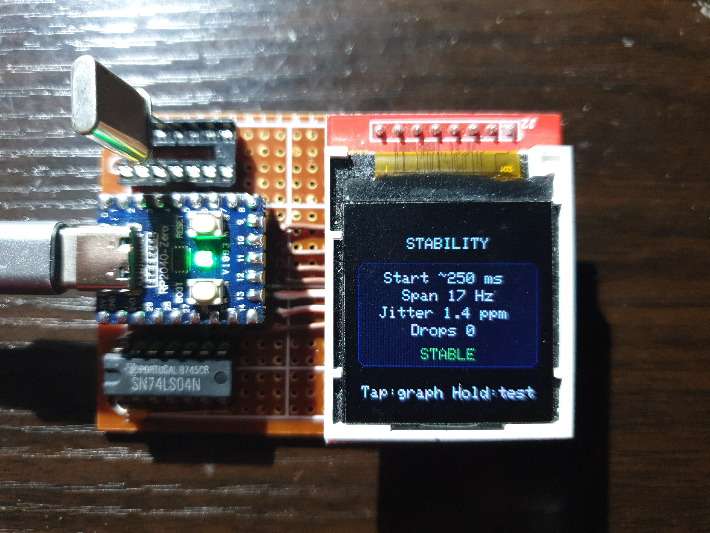

# RP2040 Quartz Tester

**Project version v1.0.0** · [Download the compiled UF2](QuartzTesterRP2040/build/QuartzTesterRP2040-v1.0.0.uf2)

A bench tester for quartz crystals, built around a **Waveshare RP2040-Zero**, a two-inverter **74LS04** oscillator with a buffered output, and a **128 × 128 ILI9163C** SPI display. The RP2040 counts rising edges on GP7 using its PWM peripheral.

*The perfboard prototype measuring 3.2761 MHz. The graph shows frequency deviation over the last eight seconds.*

## From Arduino Nano to RP2040

The first prototype used an **Arduino Nano with a 16 MHz ATmega168**. Its **Timer1** counted pulses arriving at **D5/T1**. A **74ALS74** dual D flip-flop provided two cascaded divider stages. Each stage toggled by feeding its inverted output back to its D input, producing **÷2** after the first stage and **÷4** after the second.

The initial design called for a **74LS157** to select the direct or divided signal. The three-range revision used one channel of a **74LS153** multiplexer. The Nano drove its A and B select lines from **D6** and **D7**. The unused fourth selection duplicated the ÷2 path.

| Range | D6 (A) | D7 (B) | Signal at D5/T1 |
| --- | --- | --- | --- |
| Direct | LOW | LOW | Buffered oscillator output |
| ÷2 | HIGH | LOW or HIGH | First flip-flop output |
| ÷4 | LOW | HIGH | Second flip-flop output |

The Arduino sketch accepted `1`, `2`, or `4` over USB serial at **115200 baud** to select a range. It converted the pulse count into frequency using the measurement time and multiplied by the selected division factor. Division kept the signal within the usable range of the externally clocked Timer1 input. The oscillator's ability to start with a given crystal remained a separate constraint.

The RP2040 revision counts the buffered signal with the PWM peripheral on **GP7**, eliminating the external divider and range multiplexer. The TFT and one pushbutton make the tester usable at the bench, and measurement reports are still available over USB serial.

## Schematic

Two gates of the 74LS04 form the oscillator loop. Each has a 510 Ω feedback resistor, and the crystal connects across the two-stage loop. A third gate buffers the signal for the counter. The schematic shows the USB-powered bench setup with a shared ground, 5 V for the 74LS04 and 3.3 V for the display.

[Open the full-resolution JPG](QuartzTester_RP2040/QuartzTester_RP2040.jpg)

| Signal | RP2040-Zero |
| --- | --- |
| Oscillator output `CLK_RAW` | GP7 |
| TFT SCK / SDA (MOSI) | GP11 / GP12 |
| TFT CS / A0 (DC) / RESET | GP10 / GP9 / GP15 |
| TFT VCC / LED / GND | 3V3 / 3V3 / GND |
| Pushbutton | GP13 to GND |

Match the wires to the labels on the TFT module. For the LaskaKit LA141014 V1.1, set the display supply jumper to 3.3 V. The schematic also shows an optional button on GP14. The sketch uses the button on GP13.

**Check the clock signal before connecting GP7.** The schematic shows an experimental direct connection from the 5 V 74LS04 to the 3.3 V RP2040 input. Measure the signal and any overshoot with an oscilloscope, and use level translation if the waveform falls outside the RP2040 input limits. Use a common ground.

## Build and upload

To flash the prebuilt firmware, hold **BOOT** while connecting the RP2040-Zero to USB. Copy [QuartzTesterRP2040-v1.0.0.uf2](QuartzTesterRP2040/build/QuartzTesterRP2040-v1.0.0.uf2) to the **RPI-RP2** drive. The board restarts automatically. The Frequency screen shows the installed version.

### Build from source

1. Open [QuartzTesterRP2040.ino](QuartzTesterRP2040/QuartzTesterRP2040.ino) in Arduino IDE.
2. Select **Waveshare RP2040 Zero** from the **Arduino-Pico** board package. The sketch was built with version 6.3.2.
3. Install **Adafruit ST7735 and ST7789 Library**, **Adafruit GFX Library**, and **Adafruit NeoPixel**. Accept the required library dependencies.
4. Hold **BOOT** while connecting the board to USB, then upload the sketch from Arduino IDE.

## Controls and measurements

A short press cycles through **Frequency**, **Stability**, and **Graph**. Hold the button for about 650 ms to restart the test and clear the graph history.

| Screen | What it shows |
| --- | --- |
| Frequency | Measured frequency and oscillator status |
| Stability | Approximate startup time, frequency span, dropouts, and frequency variation in ppm |
| Graph | About eight seconds of measurements, plotted as deviation from the average. Gaps mark loss of signal |

The **Jitter** line reports the RMS frequency variation across 12 measurement windows of about 250 ms each. It includes the counter's measurement uncertainty. Edge-to-edge timing jitter requires timestamping individual transitions.

If the tester has yet to confirm a signal after about three seconds, it displays **NO START** and keeps listening. The **Start** field estimates when oscillation was detected after beginning the test. **Span** is the difference between the highest and lowest readings in the stability window, and **Drops** counts detected signal losses since the test began.

### Prototype photos

| Frequency screen | Stability screen |
| --- | --- |
|  |  |
